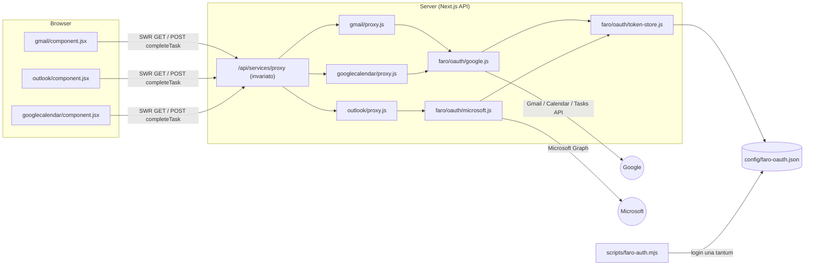

# Widget "La tua giornata": Gmail, Outlook, Google Calendar (+ Tasks)

Obiettivo: aggiungere al fork tre nuovi widget di servizio, `gmail`, `outlook` e `googlecalendar`, che mostrano le mail più recenti (con conteggio non lette) e gli eventi + task del giorno, come nel mockup.

## Contesto (cosa ho trovato nel codebase)

- Ogni widget vive in `src/widgets/<type>/` con `widget.js` (config proxy), `proxy.js` (handler lato server), `component.jsx` (UI) e i test vitest affiancati. Viene registrato in [widgets.js](file:///home/leo/Projects/faro/src/widgets/widgets.js) e [components.js](file:///home/leo/Projects/faro/src/widgets/components.js).
- Il riferimento più vicino è il widget [feed](file:///home/leo/Projects/faro/src/widgets/feed/proxy.js): proxy custom senza `endpoint`, cache con `memory-cache`, componente a lista. Prendo questo come modello.
- La card servizio ([item.jsx](file:///home/leo/Projects/faro/src/components/services/item.jsx)) disegna già header con icona, nome e descrizione ("Gmail / Personale"). Il widget disegna solo il corpo. La card è `relative`, quindi il widget può posizionare un badge in alto a destra ("3 non lette") **senza toccare il core**.
- Le azioni POST passano già dal proxy tramite `mappings` con `method: "POST"` + `segments` (pattern usato da [emby](file:///home/leo/Projects/faro/src/widgets/emby/widget.js)). Lo riuso per "completa task", quindi [proxy.js](file:///home/leo/Projects/faro/src/pages/api/services/proxy.js) resta invariato.
- La sezione "La tua giornata" a 3 colonne è un normale gruppo di servizi con `layout: { columns: 3 }` in `settings.yaml`, senza codice.
- `CONF_DIR` (`/app/config` in Docker) è scrivibile: ci salvo i token OAuth.

## Da rivedere

> [!IMPORTANT]
> **Account Outlook universitario.** Microsoft Graph richiede una _App Registration_ in Entra ID (gratuita, la crei con un account personale). Se il tenant dell'ateneo blocca il consenso utente a `Mail.Read`, al login comparirà "Need admin approval". In quel caso le opzioni sono: chiedere l'approvazione all'IT oppure usare un account personale. **Non** propongo scorciatoie come riusare il client ID di altre app (es. Thunderbird).

> [!WARNING]
> **Google, scadenza dei token.** Se l'app OAuth su Google Cloud resta in stato _Testing_, i refresh token scadono **dopo 7 giorni**. Bisogna portarla in _In production_. Non serve la verifica: per uso personale compare solo l'avviso "App non verificata" → _Avanzate → Continua_. Lo spiegherò passo passo nella documentazione.

> [!CAUTION]
> **Checkbox dei task = permesso di scrittura.** Lo scope `https://www.googleapis.com/auth/tasks` permette di modificare i task. Chi apre la dashboard può segnare task come completati, quindi conviene attivare l'auth di homepage se la dashboard è esposta. C'è un'opzione `completeTasks: false` per disattivarla.

**Decisioni di design confermate:**

1. **Tre widget separati** (`gmail`, `outlook`, `googlecalendar`) invece di estendere il widget `calendar` esistente (iCal/Sonarr/Radarr): il layout "agenda del giorno + task" è diverso e così non tocco codice upstream.
2. **Codice del fork isolato** in `src/utils/faro/` e `src/components/faro/`, così i rebase su upstream restano facili. Nel core cambiano solo righe di registrazione (vedi sotto).
3. **Badge in alto a destra**: "N non lette" per le mail. Per il calendar metto la data ("Gio 5 nov") nello stesso slot: la `description` della card è statica, quindi "Oggi · 5 novembre" sotto il titolo richiederebbe di modificare `item.jsx`.
4. **Modalità `demo: true`**: restituisce dati finti (come "Dati di esempio" nel mockup). Serve per sviluppo e screenshot senza credenziali.
5. **Calendari letti**: di default tutti i calendari selezionati/visibili sull'account Google (ciascuno con il proprio `backgroundColor` per la barra laterale), filtrabili opzionalmente con `calendars: [...]`.
6. **Eventi già passati di oggi**: mostrati attenuati di default (nascondibili opzionalmente con `hidePastEvents: true`).
7. **Calendario Outlook**: escluso dallo scope attuale (solo posta Outlook + Google Calendar/Tasks).

---

## Architettura



**Flusso token:**

1. `pnpm faro:auth google --account personale` (oppure `outlook --account polimi`) fa il login una sola volta e scrive in `config/faro-oauth.json` (permessi `0600`) `clientId`, `clientSecret` (solo Google), `tenant` (solo MS), `refreshToken` e `scopes`.
2. Il proxy chiede un access token a `getAccessToken(account)`: se in memoria ce n'è uno valido lo usa, altrimenti fa il refresh. Una promise per account evita refresh paralleli.
3. Microsoft **ruota** il refresh token (validità a scorrimento di 90 giorni): quello nuovo viene salvato subito sul file con scrittura atomica (tmp + rename). Google non lo ruota, ma la logica è la stessa.

**Esempio di configurazione finale:**

```yaml
# services.yaml
- La tua giornata:
    - Gmail:
        icon: gmail.svg
        description: Personale
        href: https://mail.google.com
        widget:
          type: gmail
          account: personale # chiave in faro-oauth.json
          maxItems: 3 # default 3
          query: "in:inbox" # opzionale, sintassi di ricerca Gmail
    - Outlook:
        icon: microsoft-outlook.svg
        description: Università
        href: https://outlook.office.com/mail/
        widget:
          type: outlook
          account: polimi
          maxItems: 3
          focusedOnly: false # opzionale: solo "Posta in arrivo evidenziata"
    - Google Calendar:
        icon: google-calendar.svg
        href: https://calendar.google.com
        widget:
          type: googlecalendar
          account: personale # stesso token di Gmail
          calendars: [] # vuoto = tutti i calendari selezionati
          showTasks: true
          completeTasks: true
          timezone: Europe/Rome # opzionale
```

```yaml
# settings.yaml
layout:
  La tua giornata:
    style: row
    columns: 3
```

---

## Modifiche proposte

### 1. Infrastruttura OAuth (codice del fork, nuovo)

#### [NEW] src/utils/faro/oauth/token-store.js

- `readAccount(key)` e `writeAccount(key, patch)` su `join(CONF_DIR, "faro-oauth.json")`.
- Scrittura atomica, `chmod 0600`, errori chiari se il file manca ("Account 'x' non collegato: esegui `pnpm faro:auth …`").

#### [NEW] src/utils/faro/oauth/google.js

```js
export async function getGoogleAccessToken(account) {
  // cache in memoria (memory-cache) fino a expires_in - 60s
  // POST https://oauth2.googleapis.com/token  grant_type=refresh_token
  // invalid_grant → errore "token revocato o scaduto, ricollega l'account"
}
export async function googleFetch(account, url, init) {
  /* Bearer + JSON + gestione errori */
}
```

#### [NEW] src/utils/faro/oauth/microsoft.js

Come sopra, con `https://login.microsoftonline.com/{tenant}/oauth2/v2.0/token` e salvataggio del refresh token ruotato.

#### [NEW] scripts/faro-auth.mjs

CLI **senza dipendenze** (solo built-in di Node 24: `fetch`, `http`, `crypto`, `readline`), così gira anche nell'immagine Docker standalone.

- `google`: flusso _loopback_ con PKCE (client OAuth di tipo "Desktop app"). Scope: `gmail.readonly`, `calendar.readonly`, `tasks`. Su un server headless basta incollare nel terminale l'URL `http://127.0.0.1:…/?code=…` a cui il browser viene rediretto, anche se la pagina non si carica.
- `outlook`: _device code flow_ (vai su microsoft.com/devicelogin e inserisci il codice). App pubblica, nessun secret. Scope: `offline_access User.Read Mail.Read`.
- Opzioni: `--account`, `--client-id`, `--client-secret`, `--tenant` (default `common`), `--config-dir`.

#### [MODIFY] package.json

```diff
     "test:watch": "vitest",
+    "faro:auth": "node scripts/faro-auth.mjs",
```

#### [MODIFY] Dockerfile

```diff
 COPY --link --from=builder --chown=1000:1000 /app/.next/static/ ./.next/static
+COPY --link --chown=1000:1000 scripts/faro-auth.mjs ./scripts/
```

In Docker: `docker exec -it -u 1000 faro node scripts/faro-auth.mjs outlook --account polimi`. `-u 1000` serve perché il file risulti di proprietà dell'utente dell'app.

---

### 2. Componenti UI condivisi (nuovo)

#### [NEW] src/components/faro/mail-list.jsx

Usato da Gmail e Outlook. Riceve `{ unread, messages: [{ id, from, subject, snippet, date, unread, link }] }` e disegna, per ogni riga:

- pallino blu se non letta, mittente in grassetto, ora allineata a destra;
- oggetto e anteprima su una riga, troncati;
- skeleton `animate-pulse` durante il caricamento, "Nessuna mail" se la lista è vuota.

Formato dell'ora con luxon: oggi → `HH:mm`, ieri → "Ieri", altrimenti `d MMM`.

#### [NEW] src/components/faro/card-badge.jsx

Pillola `absolute top-2.5 right-2.5 z-10` ("3 non lette" / "Oggi · 5 nov") con lo stile `bg-theme-…` del tema.

> Nota tecnica: `Container` (`src/components/services/widget/container.jsx`) ha `className="relative ..."`, quindi `CardBadge` va renderizzato **fuori** da `<Container>` come fratello in un Fragment (`<> <CardBadge /> <Container>…</Container> </>`), così si ancora a `.service-card` nell'header della card.

#### [NEW] src/components/faro/card-footer-link.jsx

Footer "Apri la posta →" / "Apri calendario →" con bordo superiore. Usa `service.href` e, se manca, un URL di default per provider.

Tutti usano le classi `theme-*` esistenti, quindi funzionano con i temi chiaro/scuro e i colori di homepage.

---

### 3. Widget `gmail` (nuovo)

#### [NEW] src/widgets/gmail/widget.js

```js
import gmailProxyHandler from "./proxy";
const widget = { proxyHandler: gmailProxyHandler };
export default widget;
```

#### [NEW] src/widgets/gmail/proxy.js

- `GET users/me/labels/INBOX` → `messagesUnread`.
- `GET users/me/messages?maxResults=N&q=…` (default `labelIds=INBOX`).
- Poi, in parallelo, `GET users/me/messages/{id}?format=metadata&metadataHeaders=From,Subject,Date` → `snippet`, `labelIds` (UNREAD) e `internalDate`.
- Normalizzazione: nome del mittente da `From`, decodifica delle entità HTML nello snippet, link `https://mail.google.com/mail/?authuser={email}#all/{threadId}`. L'email viene da `users/me/profile`, in cache.
- Cache server di 2 minuti per account+query. `demo: true` restituisce dati di esempio.

#### [NEW] src/widgets/gmail/component.jsx

`useWidgetAPI(widget, undefined, undefined, { refreshInterval: 2*60*1000 })` → `CardBadge` + `MailList` + `CardFooterLink`. Errori gestiti con `Container`.

---

### 4. Widget `outlook` (nuovo)

#### [NEW] src/widgets/outlook/{widget.js, proxy.js, component.jsx}

- `GET /me/mailFolders/inbox?$select=unreadItemCount`.
- `GET /me/mailFolders/inbox/messages?$top=N&$orderby=receivedDateTime desc&$select=subject,from,receivedDateTime,bodyPreview,isRead,webLink` (con `focusedOnly`: `$filter=inferenceClassification eq 'focused'`).
- Stessa forma normalizzata di Gmail, quindi il componente è quasi identico e riusa `MailList`.

---

### 5. Widget `googlecalendar` (nuovo)

#### [NEW] src/widgets/googlecalendar/widget.js

```js
import googleCalendarProxyHandler from "./proxy";
const widget = {
  proxyHandler: googleCalendarProxyHandler,
  mappings: {
    completeTask: {
      method: "POST",
      endpoint: "tasks/{tasklist}/{task}/complete",
      segments: ["tasklist", "task"],
    },
  },
};
```

#### [NEW] src/widgets/googlecalendar/proxy.js

- **GET (nessun endpoint)**:
  - `calendarList` → calendari `selected` (o quelli in `calendars`) con `backgroundColor`, che dà il colore delle barre.
  - Per ogni calendario, `events?timeMin=inizio giornata&timeMax=fine giornata&singleEvents=true&orderBy=startTime`, nel fuso `timezone` o in quello del calendario.
  - Normalizzazione: `{ id, title, start, end, allDay, location | "Google Meet" (hangoutLink), color, link: htmlLink, past }`.
  - Se `showTasks`: `tasks/v1/users/@me/lists`, poi per ogni lista `tasks?showCompleted=false&dueMax=fine giornata` → `{ id, tasklist, title, overdue }`.
  - Risposta: `{ date, events, tasks, canComplete }`. Cache di 5 minuti.
- **POST `tasks/{tasklist}/{task}/complete`**: rifiutato con 403 se `completeTasks: false`. Altrimenti `PATCH tasks/v1/lists/{tasklist}/tasks/{task}` con `{ status: "completed" }`, poi invalida la cache.

#### [NEW] src/widgets/googlecalendar/component.jsx

- Righe evento con barra colorata a sinistra, `09:00–10:30` (oppure "Tutto il giorno"), titolo e luogo. Gli eventi passati sono attenuati.
- Righe task con barra arancione, etichetta "Entro oggi" o "In ritardo" (rossa) e checkbox a destra.
- Al click sulla checkbox: aggiornamento ottimistico con `mutate()` di SWR e `POST /api/services/proxy?${params}` costruito con `getURLSearchParams(widget, "completeTask")` + `params.append("segments", JSON.stringify({ tasklist, task }))` (come in `emby/component.jsx`, perché `formatProxyUrl` serializza `query` e non `segments`). Se la chiamata fallisce si torna allo stato precedente.
- Badge con la data e footer "Apri calendario →".

---

### 6. Registrazione, i18n, documentazione (modifiche minime al core)

#### [MODIFY] src/widgets/widgets.js e src/widgets/components.js

+3 righe ciascuno (`gmail`, `googlecalendar`, `outlook`) in ordine alfabetico.

#### [MODIFY] .gitignore

Aggiunta precauzionale di `*faro-oauth*.json` (oltre a `/config` già ignorato) per impedire commit accidentali di refresh token anche con `--config-dir` personalizzato.

#### [MODIFY] public/locales/en/common.json, public/locales/it/common.json

Nuove sezioni `gmail`, `outlook`, `googlecalendar`, `faromail`: `unread_one/other` ("{{count}} non lette"), `openMail`, `openCalendar`, `noMail`, `noEvents`, `allDay`, `dueToday`, `overdue`, `notLinked`, `yesterday`.

#### [NEW] docs/widgets/services/gmail.md, outlook.md, googlecalendar.md

Guida passo passo: progetto Google Cloud (attivare Gmail, Calendar e Tasks API, consent screen _In production_, client "Desktop app"); App Registration Entra ID (account "any org + personal", _Allow public client flows_); comandi `faro:auth` (anche in Docker); opzioni YAML.

#### [MODIFY] mkdocs.yml, docs/widgets/services/index.md

Link alle tre nuove pagine.

`service-helpers.js` **non** viene toccato: tutte le opzioni restano lato server, e il proxy restituisce al client solo i dati normalizzati e `canComplete`. In più nessun segreto arriva al browser.

---

## Ordine di implementazione

1. Infrastruttura OAuth + CLI + test.
2. Componenti condivisi + `gmail` (con `demo`), verifica visiva.
3. `outlook`.
4. `googlecalendar` + task interattivi.
5. i18n, docs, lint/build finali.

## Piano di verifica

### Test automatici

Test vitest affiancati, sullo stile di quelli esistenti (`proxy.test.js` con `httpProxy`/`fetch` mockati, `component.test.jsx` con `renderWithProviders`, `widget.test.js` con `expectWidgetConfigShape`):

- token-store: lettura/scrittura atomica, account mancante.
- google/microsoft: cache dell'access token, refresh, salvataggio del token ruotato (MS), `invalid_grant`.
- proxy gmail/outlook: normalizzazione, decodifica dello snippet, `maxItems`, conteggio non lette, cache, errori HTTP.
- proxy googlecalendar: range del giorno con fuso, eventi all-day, merge di più calendari, task in scadenza o in ritardo, POST di completamento (consentito e vietato).
- componenti: skeleton, lista vuota, badge, checkbox ottimistica con rollback.

```bash
pnpm test -- src/widgets/gmail src/widgets/outlook src/widgets/googlecalendar src/utils/faro
pnpm test          # suite completa, per verificare che niente si rompa
pnpm lint
pnpm build
```

### Verifica manuale

1. `pnpm dev` con i tre widget in `demo: true`, poi screenshot e confronto con il mockup (tema scuro, 3 colonne, anche su mobile).
2. Collegare l'account Google reale con `pnpm faro:auth google` → controllare mail, non lette, eventi, task; segnare un task come completato e verificarlo su Google Tasks.
3. Collegare Outlook dell'ateneo con `pnpm faro:auth outlook`. Se compare "admin approval", provare con un account personale.
4. Riavviare il server e verificare che il refresh funzioni senza rifare il login.
